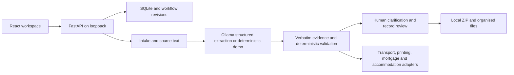

# Architecture

- One workflow config declares field order, types, conditional requirements, validators, output and reviewer. Complex cross-field rules and calculations sit in independent adapters.
- The database keys workflow versions by organisation and version, cases by organisation and thread, and messages by organisation and external message ID. A reply reference and thread must agree. A sender alone never associates requests.
- Persisted case state retains evidence, prior values, model runs, output history, review decisions and audit events. Attachments and versioned references have their own database records. Foreign keys restrict documents and messages to case lifetimes.
- New source chunks are bounded for inference. Supporting text and past conversation are supplied as untrusted data. Only exact raw spans in the cited source are admitted. Local mode performs a secondary literal check for explicit labels and records which findings required it.
- Validation and independent adapter checks gate draft output and approval. The shared engine treats missing, ambiguous, invalid and conflicting values as unresolved. The staff can record a correction and rationale while keeping earlier evidence.
- SQLite writer locks and revision checks protect updates. Model calls run outside the writer lock and results commit only against the original revision. Clarification drafts have their own edit version. An approved export captures the output snapshot for that revision.
- Export generates bytes locally and stages an isolated directory before renaming it into place. Spreadsheet string cells that could become formulas are escaped. File size and type checks run before extraction. The server checks local Host and browser Origin.
- Synthetic requests, business references and illustrative templates are separated from runtime data. User-supplied reference text is scoped by organisation and supplied as context for extraction. Printing prices and legal text are maintained separately in the reviewed configuration and project templates.
