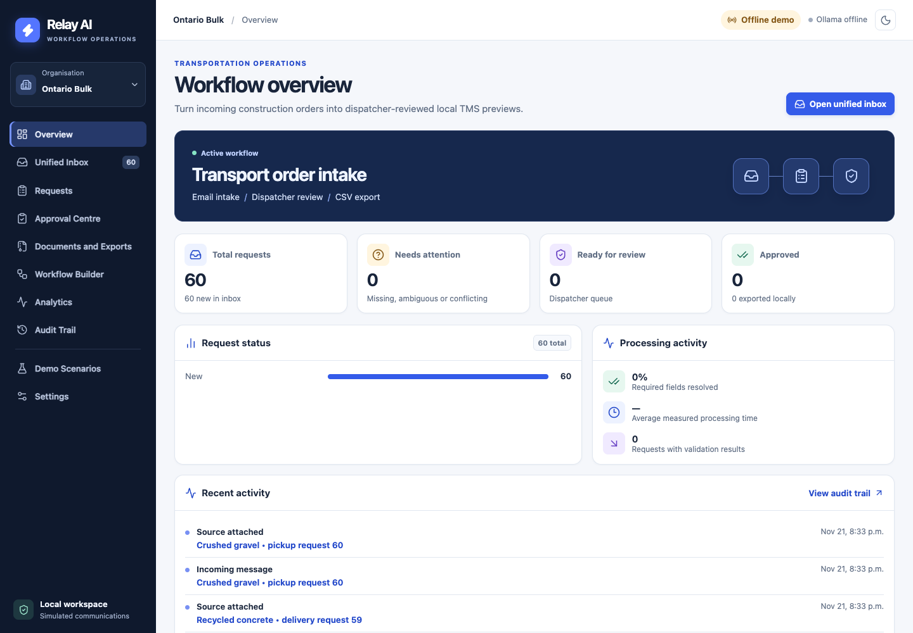
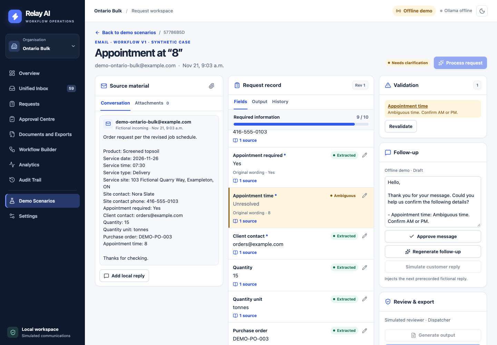

# Relay AI

Relay AI prepares evidence-backed business records from simulated intake. One workflow engine serves four Brampton AI Innovator Challenge 6 hosts. A dispatcher, owner, lawyer or staff reviewer decides what can be sent or exported.

## Run locally

This checkout uses macOS on Apple silicon, Python 3.14 and Node 26. Setup uses free packages and downloads the local Qwen3 4B model once, about 2.5 GB. It creates a workspace-local Ollama installation if no CLI is available. No account or API key is required.

```bash
./scripts/setup.sh
./scripts/start.sh
```

Open [Relay AI](http://127.0.0.1:5173). The API and Ollama listen at `127.0.0.1:8000` and `127.0.0.1:11434`. Use `./scripts/stop.sh` to stop owned services. Runtime logs, models and database live under `.local/`. If Ollama was already running, Relay reuses the listener and leaves it running when the app stops.

Use **Settings** to choose an installed local model or switch explicitly to **Offline demo**. Local AI is the initial mode, runs structured Ollama inference and verifies evidence against the source. Explicit labelled values are checked independently and any additions are marked **Literal source check**. Offline demo parses labelled text deterministically. Both modes use prerecorded fictional replies in the scenario simulator. A local AI outage does not change the selected mode.

For dependency setup without the model download, use `./scripts/setup.sh --offline-demo-only`. Then start with `./scripts/start.sh --offline-demo`. Once packages and the selected model are installed, ordinary startup needs only loopback.

## Demonstrate the four cards

| Organisation | Intake and review | Local deliverable |
| --- | --- | --- |
| Ontario Bulk | Order email, missing details, AM/PM ambiguity, contradictory sites, dispatcher review | Synthetic TMS preview, CSV, JSON and PDF |
| Studio by Grandieu | Simulated WhatsApp, synthetic price/format response, flyer specifications, owner review | XLSX order and proposed price |
| Freedman Benipal Wu LLP | Fictional title, mortgage and ledger sources, Decimal working, lawyer review | ZIP with sources, evidence, calculation and two illustrative DOCX drafts |
| Enabled Talent | Job and candidate-stated needs, employer provision gaps, staff edits | Concise PDF accommodation plan |
| Harbour Repair Co. | A configuration-only intake with conditional on-site address | JSON record for a service coordinator |

Open **Demo Scenarios** for the scripted paths. Start an unprocessed scenario with **Process request**. The source panel shows correspondence and attachments. Evidence on an extracted field links back to the source. When blocking issues are resolved, generate the output, review the revision, approve it and export. The **Workflow Builder** saves organisation names, channels, field types, conditions, ranges, options, reviewer roles and output formats as versioned configurations. New requests use the latest version. Existing requests keep the version under which they were opened.

```bash
./scripts/reset_demo.sh              # restores seeded requests only
.venv/bin/python -m pytest -q        # API and workflow tests
npm --prefix frontend run build
npm --prefix frontend test           # Playwright, installed Chrome on macOS
.venv/bin/python -m scripts.evaluate_local
```

The simulator includes 60 trucking, 10 printing, 3 mortgage and 5 accommodation cases and one Harbour Repair case. Seeded requests are stored in SQLite just like manual intake. Reset keeps custom workflows, uploaded references, separate manual cases and local exports. Use **Documents and Exports** to upload approved local references. Imports accept text-based PDF, DOCX, TXT, CSV and XLSX and flag scanned PDFs for manual review. Email intake can import plain-text `.eml` and supported attachments.

## Data, approvals and limits

Only the challenge briefs and made-up records were available. The project provides synthetic prices, order fields, source specimens and illustrative legal drafts. These require replacement with the host’s authorised materials and field mappings for any deployment. The app stores no host credentials and simulates every outgoing send. Export packages contain the reviewed revision, evidence, conversation, audit trail and source files when supplied. A new incoming source or relevant correction invalidates the prior approval. The reviewer role is simulated for this hackathon.

SQLite persists records locally. React, TypeScript and Vite render the operator workspace. FastAPI, Pydantic and SQLAlchemy own validation, evidence checks, revisions and exports. Ollama runs only on loopback. No production authentication or encryption-at-rest layer is included. Use fictional data in this demonstration. Model extraction can omit or misassign facts and requires review. The legal calculation supports the explicit, fictional simple ACT/365 ledger with no interim payments. Accommodation plans use candidate-stated needs and review prompts without suitability scoring or inferred diagnoses.

- [Architecture](ARCHITECTURE.md)
- [API documentation](API_DOCUMENTATION.md)
- [Live demonstration](DEMO_SCRIPT.md)
- [Five-minute pitch](PITCH.md)
- [Requirement mapping](REQUIREMENTS_TRACEABILITY.md)
- [Verification results](TEST_RESULTS.md)

## Screenshots




